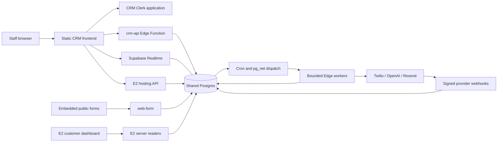
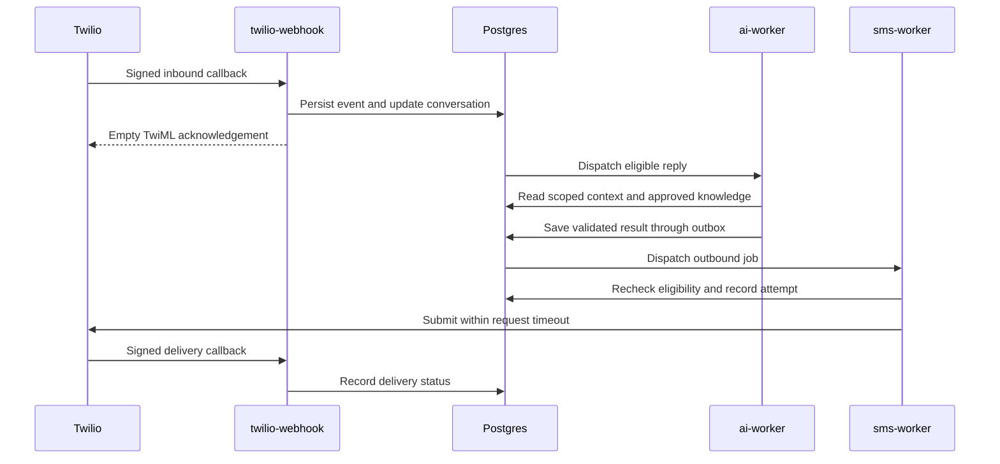
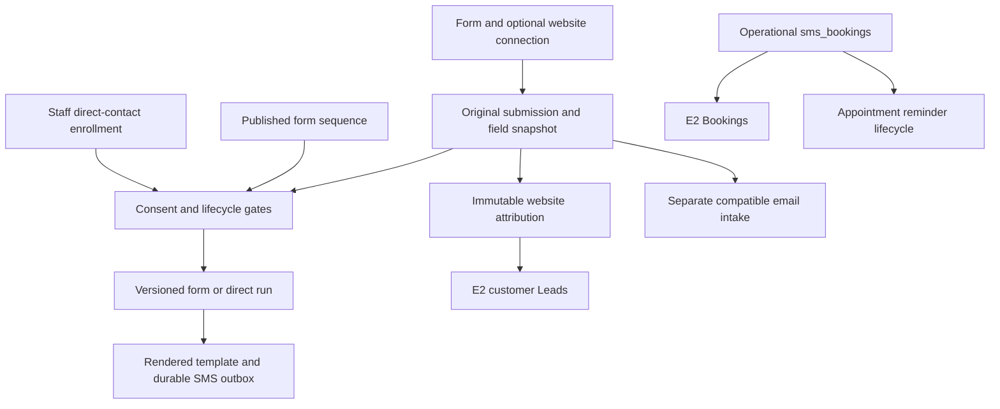

# System architecture

The staff CRM is a browser application with Supabase Edge APIs and database-owned work queues. Most business rules live in PostgreSQL functions and triggers; Edge handlers authenticate requests and invoke scoped RPCs. This guide describes checked-in implementation, not a new production audit.

## Runtime and repository map

| Location | Responsibility |
| --- | --- |
| `public/` | Browser views, shared auth, Realtime refresh, forms, hosting uploads, styles and assets |
| `src/frontend/` | Bundled React wrapper for Twilio Compliance Embeddable |
| `scripts/build-frontend.js`, `config/environments/` | Reviewed destinations, clean generated output, dependency bundles and public `dist/config.js` |
| `supabase/functions/` | Edge entrypoints and shared HTTP/auth/database adapters |
| `src/workers/` | Provider-processing logic used by Edge entrypoints |
| `supabase/migrations/` | Ordered SMS database changes and remote-history aliases |
| `supabase/sql/current/` | Maintained queue/reporting definitions, separated from one-time schema and bootstrap inputs; consistency checked against the owning migration |
| Other `supabase/sql/` files | Historical assembly inputs; later migrations replace definitions and the old assembler is retired |
| `test/` | Node tests, HTTP/provider mocks and PGlite database regressions |
| `src/index.js`, `src/routes/`, much of `src/lib/` | Legacy Express and shared utilities; trace imports before treating a library as unused |
| `src/demo.js`, `src/demoApp.js` | Synthetic read-only preview |
| `scripts/` | Build, bootstrap, packaging, verification and workstation utilities |

Render serves `dist/` as a static site. Production needs no persistent Render worker or Express process. The loopback preview serves these assets and rejects local API/webhook routes; browser requests use the configured remote API URLs.

The environment manifest fixes API, Supabase, hosting, embed and login-policy
destinations. Unknown environments or conflicting overrides fail the build.
Generated static headers hash the inline import map and explicitly allow the
required provider origins; app pages reject framing while public embeds retain
their intended use. `check` verifies policy drift and source syntax. Edge
packaging walks relative imports across allowed function/shared source roots,
including the shared phone normalizer, and fails on incomplete dependencies.

## Authentication and data access

CRM and E2 use independent Clerk applications. CRM authentication verifies RS256 signatures, issuer, required token claims and allowed `azp` origins. Browser CORS uses the exact `CRM_ALLOWED_ORIGINS` list. Customer tokens cannot substitute for CRM tokens.

The first-login/session path synchronizes a verified Clerk identity into the shared registry. Signup grants neither staff authority nor business access. Global `/platform` routes require staff authority without selecting a tenant. Business routes use `X-Tenant-ID`, with database authorization enforcing access rather than trusting the header.

The human database adapter sets `platform.actor_issuer` inside the same transaction as each RPC. It uses a scoped login, SSL, disabled prepared statements and a small pool. Workers use separate scoped logins. Browser Realtime reads use Clerk-issued tokens and database policies, not the legacy Express WebSocket service.

`platform_account_identities` maps issuer/subject pairs to stable `dashboard_accounts.id` values. `sms_businesses.tenant_id` identifies businesses. Canonical staff and memberships govern CRM access regardless of retained compatibility switches. Legacy access tables remain for compatibility/cleanup and cannot restore revoked access. See [staff CRM](STAFF_CRM.md).

Project-level Edge secrets are shared across functions. Scoped roles limit ordinary code paths but do not isolate a compromised function from sibling environment secrets. See [configuration](CONFIGURATION.md).

## Browser ownership and navigation

The request wrapper captures an explicit `X-Tenant-ID` before awaiting the Clerk
token and checks session/user identity around token and response delivery. A
Clerk account change invalidates the cache, cancels reads, disposes retained
editors/media and subscriptions, clears business drafts and re-authorizes the
workspace. Bootstrap reads belong to that new identity, outside the cancelled
page render. Business selection also retires the prior Realtime connection and
its timers before connecting the selected workspace.

Ordinary tabs retain mounted nodes and drafts within one authorized workspace.
Voice/Calls retain their models but remount live controls and release media on
departure. Each platform instance owns its host and read generation; reads are
cancelled on departure and capped at 30 seconds. Platform writes can finish
while another tab is used; they no longer hold a global navigation barrier.
Completion guards prevent retired profile/email/booking actions from changing
another page or business. Saved background work marks retained content stale
instead of replacing a draft. See [tabbed workspace](TABBED_WORKSPACE.md) and
[performance](WORKSPACE_PERFORMANCE.md) for cache and refresh rules.

Website uploads run four PUTs at a time within a 120-second batch deadline.
Site details use E2's paginated single-site endpoint; directory reads do not
load all deployments or query object storage per site. A detail read checks the
publication manifest with a five-second storage deadline and validates the live
deployment belongs to the site even when it is outside the displayed page.

E2 also owns the hosting mutation coordinator. Prepare, build, publish,
unpublish and deletion serialize per site; database writes require the operation's
token and generation. Expired or uncertain storage operations hold that site for
explicit reconciliation. Other sites remain independent. The CRM displays the
API's conflict/recovery response; it cannot release the hold or infer that a
timed-out write failed. See [hosting operations](../../E2local-main/docs/web-hosting.md#operation-recovery)
and the [E2 architecture](../../E2local-main/docs/architecture.md) for customer
session isolation, scoped readers, public intake and private storage boundaries.

## SMS lifecycle

Manual sends, rendered form/direct templates, eligible inbound AI replies and voice-requested texts converge on the durable SMS outbox. Queuing returns before delivery. Opt-out, sending state, consent/purpose, schedules and conversation-generation checks apply along the relevant paths. Inbound webhooks do not send AI replies synchronously.

An SMS submission that might have reached Twilio becomes `submission_unknown` on uncertainty. It is not automatically resent; callbacks and operator reconciliation determine its outcome. Deduplication and leases reduce duplicate work but do not promise universal exactly-once provider delivery.

## Worker inventory

These are claim-loop limits from the Edge entrypoints. They limit when another job can start, not total wall time including an already-running provider request.

| Edge function | Queue or source | Database URL | Jobs / budget | Bearer secret |
| --- | --- | --- | --- | --- |
| `sms-worker` | `sms_send_jobs` | `SMS_SENDER_DATABASE_URL` | 5 / 40s | `SMS_WORKER_SECRET` |
| `automation-worker` | `automation_jobs` | `SMS_AUTOMATION_DATABASE_URL` | 25 / 35s | `AUTOMATION_WORKER_SECRET` |
| `ai-worker` | `ai_reply_jobs` | `SMS_AI_DATABASE_URL` | 1 / 40s | `AI_WORKER_SECRET` |
| `provisioning-worker` | `provisioning_jobs` | `SMS_AUTOMATION_DATABASE_URL` | 1 / 40s | `PROVISIONING_WORKER_SECRET` |
| `knowledge-worker` | `knowledge_ingest_jobs` | `SMS_AI_DATABASE_URL` | 1 / 40s | `KNOWLEDGE_WORKER_SECRET` |
| `embedding-worker` | `embedding_jobs` | `SMS_AI_DATABASE_URL` | 1 / 40s | `EMBEDDING_WORKER_SECRET` |
| `handoff-worker` | `handoff_alert_jobs` | `SMS_SENDER_DATABASE_URL` | 3 / 40s | `HANDOFF_WORKER_SECRET` |
| `compliance-worker` | `compliance_jobs` | `SMS_AUTOMATION_DATABASE_URL` | 1 / 40s | `COMPLIANCE_WORKER_SECRET` |
| `email-worker` | Email jobs via `email_claim` | `SMS_AUTOMATION_DATABASE_URL` | 5 / 20s | `AUTOMATION_WORKER_SECRET` |

The generic worker authenticates before entering a database admission slot, claims leased work, processes bounded batches and releases its slot. Cron runs `dispatch_edge()` every five seconds for ready generic queues; email has a separate minute-based dispatcher and its own claim/retry implementation. Idle queues do not require a fresh worker heartbeat every tick.

Email consumes the shared automation admission budget. Recovery batches use
locked-row skipping and bounded scans; uncertain sends beyond the provider
idempotency window are not automatically resubmitted. Rotating tenant admission
and per-tenant scheduler cursors reduce starvation, including due records that
remain ineligible. This is bounded scheduling, not a strict fairness guarantee
across provider workloads. Heartbeats summarize recent activity per queue;
their count is not the number of concurrent worker processes or connections.

Activity reporting maintains the first accepted contact in a private projection
with transactional triggers and an initial migration backfill. Indexed
quiet-period reads and early candidate/cohort filtering reduce repeated scans.
Real PostgreSQL query plans, concurrent workloads and backfill duration still
need measurement; source tests do not establish production capacity.

Other Edge functions are `crm-api`, `web-form`, `twilio-webhook`, `business-events`, `email-webhook`, `compliance-session`, `voice-agent`, `soni-voice-inbound`, `voice-lookup`, `voice-booking`, `voice-runtime` and `voice-maintenance`. See the [API reference](API_REFERENCE.md) for their caller contracts.

## Forms, automations and bookings

Forms own collection and their published SMS sequences. Direct templates support
staff enrollment without a form. Existing runs retain immutable versions and
per-contact overrides. Reply policy, opt-out, consent, contact blocking, send
windows and generation checks fence dispatch and provider submission. Appointment
reminders are distinct from enquiry follow-ups. Fixed groups/intake remain for
history and independent email compatibility, not legacy SMS generation.

The separate inbound agent processes `sms-agent-v1` jobs in off/shadow/live mode.
Only live, eligible runs may perform permitted mutations or queue replies;
shadow records proposals. Booking needs explicit verified-customer confirmation,
shared capacity rules and the live validation gate. Associated enquiry outcomes
require explicit references, not newest-record or phone-only inference.

A Booking form creates a submission/reminder intake; it does not itself create
an operational appointment. Operational bookings have separate database hooks
and E2 readers. See [forms](FORM_AUTOMATIONS.md), [direct sequences](DIRECT_CONTACT_AUTOMATIONS.md),
[Inbound AI](INBOUND_AI.md), [activity](AUTOMATION_ACTIVITY.md), and
[email](EMAIL_AUTOMATIONS.md).

## Voice runtime

`voice-lookup` exposes restricted verified customer reads; `voice-booking` uses
separate prepared/confirmed booking wrappers. `voice-runtime` records configuration
observations, calls, outcomes and private audio uploads for the registered Opek
business. `voice-maintenance` runs retention cleanup with a dedicated bearer and
role; it is not one of the nine queue workers. Staff create/manage drafts and
publish connected agents through CRM. Customer projections require active owner
and explicitly released Voice service. The external worker and phone connection
must be configured separately for new drafts. See [Voice CRM](VOICE_CRM.md) and
[Customer Voice](CUSTOMER_VOICE.md).

## External ownership

Website enrichment and public knowledge ingestion share `src/lib/publicHttps.js`.
It allows public HTTPS destinations, validates DNS results and redirects, pins
connections to a verified address, bounds response bytes and enforces deadlines.
Knowledge extraction also fences completion before saving after its 30-second
budget. Private storage reads retain their own configured authorization. The
pinned transport needs a hosted Deno compatibility smoke; Node tests alone do
not validate that runtime.

E2 owns the customer application, hosting API, Cloudflare delivery implementation, canonical registry migrations, website attribution, customer booking readers and dashboard cache. SMS owns original submissions, messaging consent, automation and provider delivery. The Soni LiveKit worker lives in the sibling `voice agent` project; this checkout implements its CRM bridge and Twilio inbound routing.

Consult the [database inventory](DATABASE_INVENTORY.md) and [E2 integration](WEBSITE_E2_INTEGRATION.md) before changing shared records. Migration filenames alone do not prove live deployment state.

The [October 14 release guide](HARDENING_RELEASE.md) identifies the owning forward
migrations, one-time SQL bootstrap boundary, E2 API-before-CRM dependency, paired
source fingerprints and remaining hosted checks. No live rollout is implied by
this architecture description.
